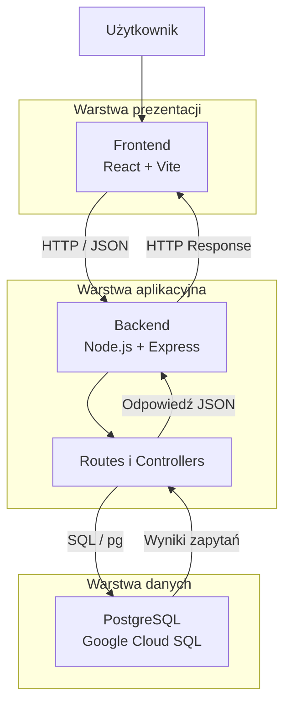

# Architektura systemu rezerwacji miejsc w kinie

System wykorzystuje architekturę trójwarstwową, składającą się z warstwy prezentacji, warstwy aplikacyjnej oraz warstwy danych.

## Schemat architektury

## Opis warstw

1. **Warstwa prezentacji:** React i Vite odpowiadają za interfejs użytkownika oraz wyświetlanie danych.
2. **Warstwa aplikacyjna:** Node.js i Express obsługują żądania HTTP, REST API, walidację oraz logikę operacji CRUD.
3. **Warstwa danych:** PostgreSQL w Google Cloud SQL przechowuje dane o filmach.

## Przepływ danych

1. Użytkownik wykonuje operację w aplikacji React.
2. Front-end wysyła żądanie HTTP do REST API.
3. Back-end przetwarza żądanie i wykonuje odpowiednie zapytanie SQL.
4. PostgreSQL zwraca wyniki do back-endu.
5. Express przekazuje odpowiedź w formacie JSON do front-endu.
6. React aktualizuje widok aplikacji.
